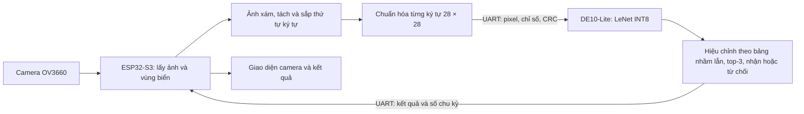

# Nhận diện biển số với ESP32-S3 và FPGA DE10-Lite

Đồ án nghiên cứu hệ thống nhận diện biển số: camera OV3660 chụp ảnh, ESP32-S3 tiền xử lý và tách ký tự, FPGA DE10-Lite thực hiện suy luận mạng LeNet với trọng số INT8. Kết quả được đưa trở lại ESP32 để hiển thị và giám sát.

## Luồng xử lý trên kit

Bản firmware và FPGA 30 lớp hiện tại xử lý biển một hàng gồm 8 ký tự; nhãn đúng chỉ được dùng để chấm sau suy luận. Xem [giao thức UART, chân nối và trạng thái kiểm thử](docs/UART_PROTOCOL.md). Kết nối UART từng được kiểm tra với một ký tự, kết quả này không chứng minh độ chính xác camera toàn tuyến.

## Mô hình và phần cứng

Mạng dùng đầu vào ảnh xám 28 × 28, hai tầng tích chập với 6 và 16 kênh, Tanh và average pooling, sau đó các tầng fully connected 120 và 84 neuron và lớp đầu ra. FPGA dùng trọng số lượng tử INT8. Mã RTL, bộ điều khiển, bảng trọng số và mạch UART nằm trong `fpga/`; firmware và giao diện nằm trong `esp32/`.

Phiên bản `fpga/experimental/` là thiết kế song song đang nghiên cứu. Mô phỏng lõi ghi 50.914 chu kỳ/ký tự, tương đương khoảng 1,018 ms tại 50 MHz; đây không phải thời gian xử lý toàn biển thực tế. Chi tiết và giới hạn xem [báo cáo tối ưu FPGA](docs/FPGA_OPTIMIZATION.md).

## Phần đã huấn luyện

`model/best.pt` là checkpoint FP32 31 lớp của thử nghiệm nhận diện biển một hàng và hai hàng; `model/generated31/` chứa trọng số INT8 đã xuất. Mô hình này là bản nghiên cứu, **chưa tương thích trực tiếp với RTL/bitstream 30 lớp của kit**. Mã trong `training/` thể hiện các bước dựng dữ liệu, huấn luyện, tách ký tự và đánh giá.

Thử nghiệm 31 lớp dùng ảnh tổng hợp: 2.700 biển train, 460 validation, 380 calibration và 800 test tách theo danh tính. Trên 800 ảnh test tổng hợp, 740 biển được nhận và đúng (92,50% toàn bộ); trong 402 ảnh có phông giữ riêng, 357 biển được nhận và đúng (88,81%). Các chỉ số này chưa chứng minh độ chính xác trên biển thật hoặc toàn tuyến camera–FPGA. Phân tích nhầm lẫn và định nghĩa phép đo ở [báo cáo huấn luyện](docs/TRAINING_REPORT.md); số liệu tổng hợp và lịch sử train ở [`model/training-results/`](model/training-results/).

## Cấu trúc thư mục

| Đường dẫn | Nội dung |
|---|---|
| `esp32/` | Firmware camera, tiền xử lý, UART và giao diện web |
| `fpga/standard/` | RTL và trọng số 30 lớp |
| `fpga/experimental/` | Project Quartus và RTL tối ưu thử nghiệm |
| `model/` | Checkpoint 31 lớp, dữ liệu INT8 và kết quả huấn luyện tổng hợp |
| `training/` | Mã nghiên cứu huấn luyện và đánh giá |
| `docs/` | Giao thức, kết quả huấn luyện và tối ưu FPGA |

## Giới hạn tái lập

Bản xuất không bao gồm ảnh camera, dữ liệu nguồn, toàn bộ phông/nền tổng hợp hoặc mọi phụ thuộc của các script. Một số đường dẫn trong script tham chiếu môi trường máy gốc. Vì vậy cần bổ sung dữ liệu và cấu hình trước khi train lại trên máy khác. Danh sách danh tính loại khỏi quá trình dựng dữ liệu trong `training/build_data.py` đã để trống để tránh công bố biển số; cần thiết lập lại để giữ phân tách train/test độc lập. Dữ liệu cá nhân và dự đoán theo từng biển không được đưa vào bản xuất.
